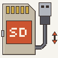

# rp2040-retro-sdmount



把 RP2040 掌機的 SD 卡變成 **USB 隨身碟**。不用再關機拔卡：從載入器選單啟動這支 APP，
接上電腦，直接把新的 `.uf2` 和封面複製進去。

屬於 [rp2040-retro-handheld](https://github.com/pondahai/rp2040-retro-handheld) 生態系，
在 [rp2040-retro-loader](https://github.com/pondahai/rp2040-retro-loader) 的選單裡是一個普通項目。
設計見 [rp2040-retro-sdk `docs/SD-MOUNT-PLAN.md`](https://github.com/pondahai/rp2040-retro-sdk/blob/main/docs/SD-MOUNT-PLAN.md)。

> **S2 階段**：USB 隨身碟 + 序列埠指令，電腦送 `done` 或掌機按 START 就回選單。✅ 2026-11-14 上機驗證通過。
> （S1：只有隨身碟、RESET 回選單 —— ✅ 2026-11-14 上機驗證通過）
>
> ⚠️ 需要**同時更新載入器**（rp2040-retro-loader 的 `RETRO_MSG_SHOW_MENU` 支援）。舊載入器上按 START
> 或送 `done` 會直接重新進入本 APP，而不是回選單；這時按實體 RESET 一樣能回去。

## 最快的用法：retro-sync

掌機停在載入器選單、USB 接著電腦，一行就好：

```bash
pip install pyserial hidapi
python host/retro_sync.py push RetroFoo.uf2
```

它會自動：叫載入器啟動 SDMOUNT → 等磁碟出現 → 複製（`.uf2` 旁邊同名的 `.RAW` 封面會一起帶上）
→ 退出磁碟 → 讓掌機回選單。新 APP 馬上就在選單裡。

| 指令 | 作用 |
| :--- | :--- |
| `push <檔案...>` | 全流程 |
| `mount` | 只掛載，印出磁碟位置（之後自己複製） |
| `finish` | 退出磁碟並讓掌機回選單 |
| `status` | 掌機目前在載入器選單、SDMOUNT，或找不到 |

- 需要新版載入器（rp2040-retro-loader 的 USB 指令通道，§4.3）。
- 磁碟機代號自動偵測只支援 **Windows**（靠 SDMOUNT 的 SCSI 名稱 `RETRO SD Mount` 找）；
  其他系統用 `--drive /media/...` 指定掛載點，並自己退出磁碟後再 `finish`。
- 掌機正在跑別的 APP 時找不到它（只有載入器選單與 SDMOUNT 有開 USB），先按 RESET 回選單。

## 手動用法

1. 把 `SDMOUNT.UF2` 與 `SDMOUNT.RAW` 放進 SD 卡**根目錄**（第一次只能用讀卡機放）
2. 開機 → 選單選 **SDMOUNT** → A
3. USB 線接電腦，電腦會出現一個磁碟，就是 SD 卡
4. 複製檔案
5. **先在電腦上「退出」那個磁碟**，掌機畫面變成 `EJECTED / Safe to remove`
6. 回選單，三選一：
   - 掌機按 **START**
   - 電腦送 `done`：`python tools/sdmount_cli.py done`（需要 `pip install pyserial`）
   - 按實體 **RESET**

   還沒退出時，START 與 `done` 都會被拒絕（畫面提示先退出），免得 FAT 寫到一半。

### 序列埠指令

USB 同時出現一個序列埠（VID:PID `CAFE:4004`）。一行一個指令：

| 指令 | 回覆 |
| :--- | :--- |
| `ping` | `retro-sdmount S2` |
| `status` | `state=<no-card\|waiting\|mounted\|ejected\|unplugged> card=<0\|1> mb=<容量> r=<KB> w=<KB> err=<次數>` |
| `done` | 已退出：`ok`，接著回選單；還掛著：`error: eject the drive first` |

畫面狀態：

| 顯示 | 意思 |
| :--- | :--- |
| `SD: NOT FOUND` | 沒插卡或卡壞了；電腦會看到一台「沒插卡」的讀卡機 |
| `USB: WAITING FOR PC...` | 還沒接電腦 |
| `USB: CONNECTED` | 電腦已掛載，可以複製 |
| `USB: EJECTED` | 電腦已退出，可以按 START 回選單 |
| `USB: CABLE UNPLUGGED` | 沒退出就拔線了 —— 資料多半已寫入，但不保證 |
| `R ... KB  W ... KB` | 累計讀寫量；出現 `ERR` 表示有磁區讀寫失敗 |

## 設計重點

- **不開檔案系統**：掌機只把 SCSI 讀寫轉成 SD 磁區讀寫（`sdcard.c` 的 `disk_read` / `disk_write`），
  FAT 完全由電腦管。兩邊同時改 FAT 卡就會壞。
- **USB 複合裝置**（TinyUSB）：MSC + CDC 序列埠。
- **回選單用載入器的跨重置訊息**：軟體重置前在 `watchdog_hw->scratch[0]` 寫 `RETRO_MSG_SHOW_MENU`
  （定義在 rp2040-retro-loader `common/boot_map.h`，編譯時直接 include 那一份）。
- **不掃鍵盤**，但會把 595 的 LATCH（GPIO 14）停在高 —— 現行接線下鍵盤 CLOCK 與 LCD D/C 共用，
  LATCH 浮接的話鍵盤 LED 會亂閃。
- 速度受限於 USB 1.1 全速，實際約 0.8～1 MB/s。

## 編譯

需要 pico-sdk 與 arm-none-eabi-gcc（可直接用 arduino-pico 附的那一套），旁邊要有 `rp2040-retro-loader`
（取連結腳本與跳板）。

```bash
cmake -S . -B build_offset -G Ninja -DPICO_BOARD=pico -DLOADER_OFFSET_BUILD=ON \
      -DPICO_SDK_PATH=<pico-sdk> -DPICO_TOOLCHAIN_PATH=<arm-none-eabi-gcc 的 bin>
ninja -C build_offset
```

產出（`build_offset/`）：

| 檔案 | 用途 |
| :--- | :--- |
| `SDMOUNT.UF2` | 放 SD 卡根目錄給載入器用。前 16KB 是空的，**不能**單獨 USB 燒錄 |
| `SDMOUNT.RAW` | 選單封面，跟上面一起放 |
| `SDMOUNT_standalone.uf2` | 夾了跳板，可直接拖進 `RPI-RP2` 測試 |

> **uf2 轉換用預編譯的 picotool**：pico-sdk 預設會從原始碼編 picotool，這台開發機上編出來的
> 一執行就 segfault（rp2040-retro-editor 也一樣）。CMakeLists 會自動找 arduino-pico 附的
> `pqt-picotool`，也可以用 `-DPICOTOOL_EXE=<路徑>` 指定。

封面由 `tools/make_icon.py` 產生（需要 Pillow），改完重跑即可。

## 已知事項

- USB VID/PID 是開發測試碼 `0xCAFE:0x4004`（S1 是 `0x4003`），公開散布前要換正式的。
- 封面只有 11 色，比 [ICON-STYLE.md](https://github.com/pondahai/rp2040-retro-handheld/blob/main/docs/ICON-STYLE.md) 建議的少，之後可以加明暗。

## 授權

MIT。`vendor/drivers/` 的 FatFs 與 SD 驅動沿用 rp2040-retro-editor（源自 rp2040-ili9341-infones），各自保留原授權。
